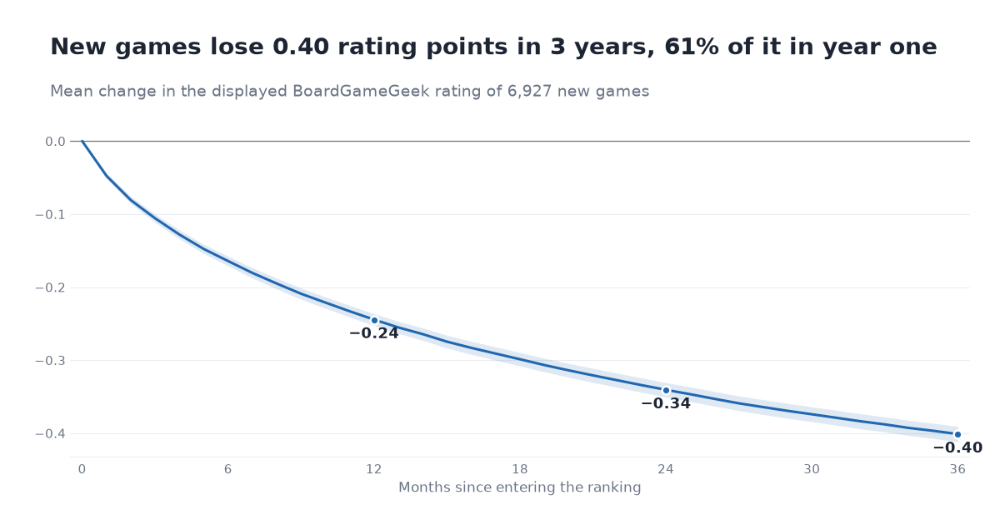

# Does the hype fade?

**How board-game ratings change after launch: ten years of BoardGameGeek data, {{n_main_sample:,.0f}} new releases, three years each.**

{{#if github_repo}}[](https://github.com/{{@github_repo}}/actions/workflows/ci.yml) {{/if}}  

<p align="center"></p>

<p align="center">{{#if dashboard_url}}<b><a href="{{@dashboard_url}}">Interactive dashboard</a></b> &nbsp;|&nbsp; {{/if}}{{#if pages_url}}<a href="{{@pages_url}}">Project page</a> &nbsp;|&nbsp; {{/if}}<a href="reports/writeup.md">Full write-up</a> &nbsp;|&nbsp; <a href="docs/findings.md">Technical findings</a></p>

## The short version

- A new board game's rating on BoardGameGeek **falls {{change_36|abs:.2f}} points in its first three years** on average. **{{share_of_decline_by_12|pct:.0f}}%** of that drop happens in year one, and **{{share_declining|pct:.0f}}%** of games end lower than they started.
- The decline isn't finished after three years: **the newest raters still score games {{gap_k36|abs:.2f}} below the displayed average.**
- **Hype doesn't decide how far a game falls; it decides how fast.** Heavily hyped games reach their lower rating within months, quiet releases take years.
- A rating becomes reliable (within ±0.25 of its 3-year value for 80% of games) after about **{{q4_rule_month:.0f}} months**. A simple adjusted launch rating gets close to that by month 6.

## Key findings

### 1. Launch ratings oversell, and most of the correction comes in year one


Followed from the month they enter the ranking, {{n_main_sample:,.0f}} new releases lose {{change_12|abs:.2f}} points by month 12, {{change_24|abs:.2f}} by month 24 and {{change_36|abs:.2f}} by month 36. Over the same calendar months, {{n_control_games:,.0f}} established games drifted by only {{control_drift_36|abs:.3f}}, so the fall belongs to the new releases, not to the site as a whole.

### 2. The newest raters still rate below the number on the page


Backing out the average of only the recently added ratings shows that new raters score games {{gap_k3|abs:.2f}} below the displayed average at month 3, and still {{gap_k36|abs:.2f}} below at month 36. The displayed number is a running average, so it carries the launch crowd's enthusiasm for years.

### 3. Hype changes the speed of the fall, not its size


By month 6 the most-hyped quarter of games has lost {{change_6_by_hype_q4|abs:.2f}} points and the least-hyped quarter {{change_6_by_hype_q1|abs:.2f}}. By month 36 they have nearly converged ({{change_36_hype_q4|abs:.2f}} vs {{change_36_hype_q1|abs:.2f}}). Controlling for the starting rating, the hype effect on the 3-year change is {{spec_a_hype:+.3f}}; measured only after the hype window, it is {{spec_b_hype:+.3f}}. The original hypothesis, that hyped games fade more, is **not supported**: hyped games simply finish fading sooner.

### 4. Trust a rating after about a year, or adjust it on day one


At launch only {{q4_within_025_k0|pct:.0f}}% of games are within ±0.25 of their 3-year rating; 80% is reached at month {{q4_rule_month:.0f}}. An adjusted launch rating (a three-variable model trained on 2017–2019 releases and tested on 2020–2023) is within ±0.25 for {{q4_test_adj_within_k0|pct:.0f}}% of games at launch (displayed rating: {{q4_test_raw_within_k0|pct:.0f}}%) and {{q4_test_adj_within_k6|pct:.0f}}% by month 6. Meanwhile {{share_rank_improved_36|pct:.0f}}% of games *climb* in BGG's rank while their raw average falls, because the rank rewards accumulating ratings.

## What the project involved

- **SQL pipeline in DuckDB** over {{n_snapshot_rows:,.0f}} rows from {{n_snapshots:,.0f}} monthly snapshots: numbered, commented SQL files driven by one config file, idempotent stages, a single CLI.
- **Data-quality work:** detecting truncated snapshot files, removing {{n_dup_rows_removed:,.0f}} duplicate rows, cleaning junk metadata, and bounding the rounding error of a derived metric. {{n_qc_pass:,.0f}} automated checks, all passing.
- **Cohort and panel analysis** of {{n_new_releases:,.0f}} new releases, with a documented sample waterfall and a control group for site-wide drift.
- **Statistics:** a game fixed-effects event study, robust regressions, game-level bootstrap intervals and an eight-variant robustness grid.
- **Prediction:** an out-of-sample check of when a rating can be trusted, and a simple model that corrects launch ratings.
- **Honest reporting:** the headline hypothesis was not supported, and the analysis says so.
- **Communication:** an interactive Streamlit dashboard (with a lookup for any new release), a static project page and a written report, with every number generated from one file (`key_numbers.json`).
- **Engineering:** type hints, ruff, pytest and CI on every push.

## Method in brief

One snapshot per month (October 2016 to October 2026) of BGG's ranked list. A game's *entry month* is the first month it appears; games already ranked in the first snapshot are excluded, and a *new release* is a game published no earlier than the year before it entered. The outcome is the raw average rating, not BGG's Bayes average. Standard errors are clustered by game or heteroskedasticity-robust; intervals are 95%, with a game-level bootstrap for ratios. Full definitions are in [`docs/data_notes.md`](docs/data_notes.md) and [`config.yaml`](config.yaml).

## Limitations

- A game enters the ranking only at 30 ratings, so its very first ratings are folded into month 0: the analysis measures change *after* entry.
- Observational data: these are patterns, not causal effects. "Hype" (growth in raters) also reflects print runs, distribution and price.
- Regression to the mean and self-selection of the launch audience can't be fully separated.
- The new-rater average is approximate (rounding, edited ratings) and over-represents fast-growing games.
- One enthusiast platform. The Kickstarter comparison ({{q3_change_36_kickstarted_1|abs:.2f}} vs {{q3_change_36_kickstarted_0|abs:.2f}} fall) uses a 2022 metadata snapshot and is descriptive only.
- Monthly snapshots; a daily-data robustness check is left for future work.

## Repository

```
sql/            numbered, commented SQL: load, cohorts, panel, quality checks
src/bgg/        pipeline (download, build, qc), analysis/, figures, dashboard extract, static site
app/            Streamlit dashboard (reads only app/data: tables, key numbers and a per-game extract)
config.yaml     every threshold, date and rule used anywhere
reports/        write-up, figures, tables, model outputs, key_numbers.json, quality-check report
tests/          unit and integration tests (data-dependent tests skip when data is absent)
docs/           data notes, technical findings, deployment, project history
scripts/        README renderer, screenshots, GitHub Pages publisher
```

## Reproduce

Requires [uv](https://docs.astral.sh/uv/) and Python 3.11+.

```bash
uv sync
uv run bgg all                  # download ({{download_mb:.0f}} MB), load, cohorts, panel, quality checks
uv run bgg analysis             # figures, models, key_numbers.json
uv run bgg dashboard-data
uv run streamlit run app/streamlit_app.py
uv run bgg export-static        # reports/site/: project page + static dashboard
uv run pytest && uv run ruff check .
```

Downloads are resumable and retried. If GitHub is slow from your network, set `HTTPS_PROXY` or use `uv run bgg download --backend git`. Individual stages: `bgg download | load | cohorts | panel | qc`.

## Data and licence

- **Code:** MIT (see [`LICENSE`](LICENSE)). The licence covers the code only, not the data.
- **Data:** daily BGG ranking snapshots from [beefsack/bgg-ranking-historicals](https://github.com/beefsack/bgg-ranking-historicals). The archive has no licence file, so the snapshot files are not redistributed; the pipeline downloads them. The published dashboard shows per-game ratings, ranks and rater counts derived from them (facts BoardGameGeek shows publicly), and group averages only for the third-party Kickstarter metadata. Data © BoardGameGeek; this project is not affiliated with BoardGameGeek.
- **Metadata:** "Board Game Database from BoardGameGeek" by threnjen on Kaggle (CC BY-SA 3.0), used for the crowdfunding comparison and not redistributed.

---

{{#if author}}Analysis and code by {{@author}}.{{/if}}
