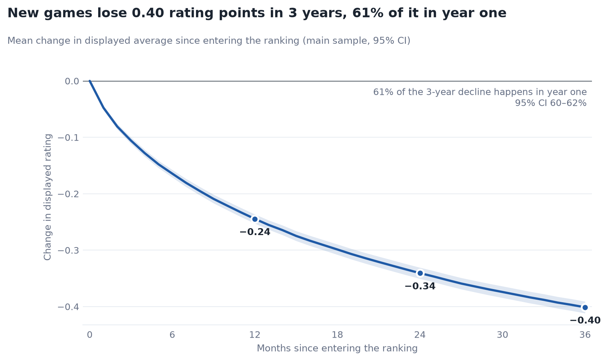
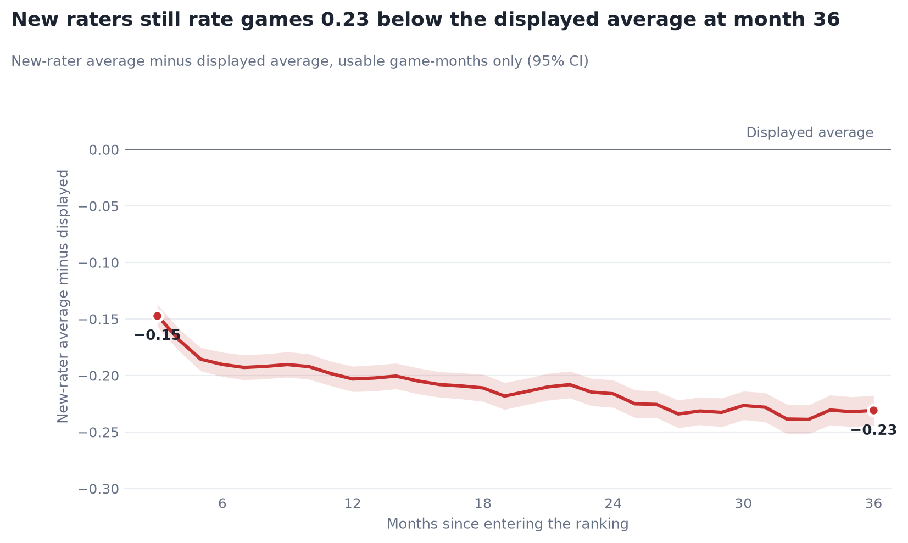
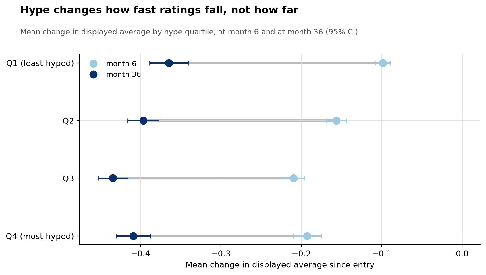
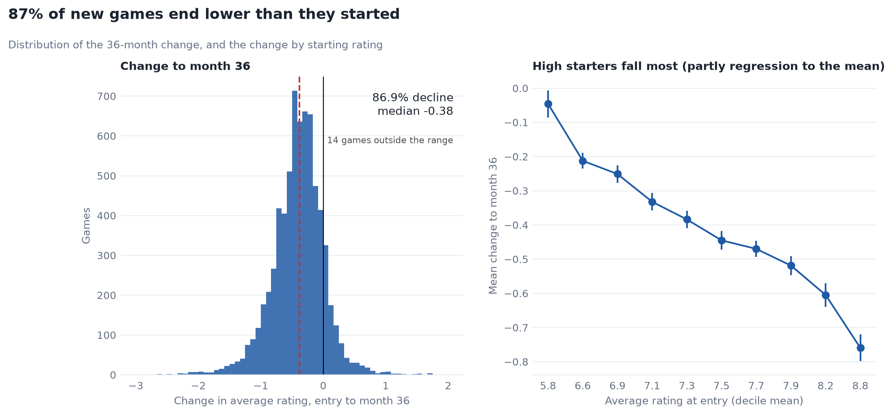
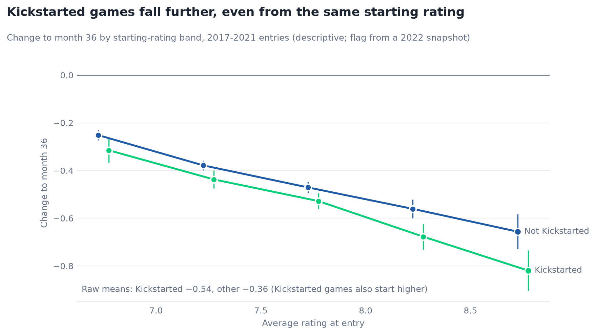
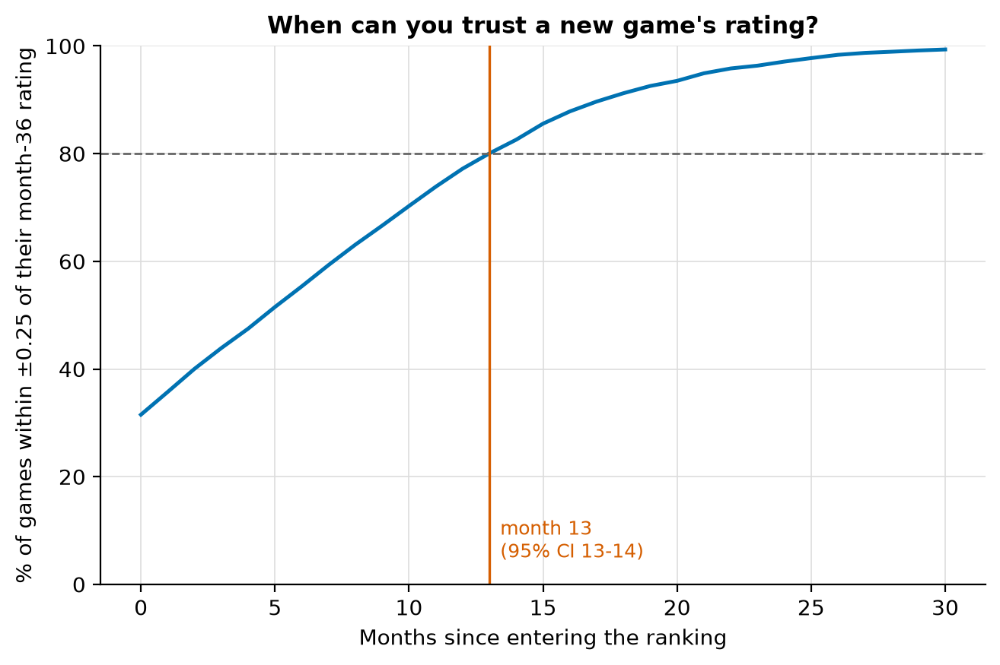

# Does the hype fade?

### What ten years of BoardGameGeek data says about trusting launch ratings

*By Nikita Reznichenko. Explore the [interactive dashboard](https://bgg-hype-fade.streamlit.app/), the [project page](https://nikitorezz.github.io/bgg-hype-fade/) or the [code](https://github.com/nikitorezz/bgg-hype-fade).*

---

## In short

- The average new board game's rating on BoardGameGeek (BGG) **falls 0.40 points in its first three years**. **61%** of that drop comes in year one, and **87%** of games end lower than they started.
- The decline isn't finished after three years: **the newest raters still score games 0.23 below the displayed average.**
- **Hype doesn't decide how far a game falls; it decides how fast.** Heavily hyped games reach their lower rating within months; quiet releases take years.
- A rating becomes reliable (within ±0.25 of its 3-year value for 80% of games) after about **13 months**. A simple adjusted launch rating gets close to that by month 6.

---

## The question

Online ratings drive buying decisions, but a product's first raters are rarely typical. They are the fans, the backers and the people who preordered. Research on books and consumer goods shows that early reviews tend to be more positive than later ones (Li & Hitt, 2008; Godes & Silva, 2012; Hu, Pavlou & Zhang, 2017). Board-game players even have a name for it, the "cult of the new" (Booth, 2022). Yet studies that use BGG data usually treat a game's rating as a fixed measure of quality.

I asked three questions:

1. **How much, and how fast, do new games' ratings change after launch?**
2. **Do the most-hyped launches fall hardest?**
3. **When can you trust a new game's rating?**

## The data

The [bgg-ranking-historicals](https://github.com/beefsack/bgg-ranking-historicals) archive holds BGG's full ranked list for every day since October 2016. I took one snapshot per month (121 snapshots, 2.6 million rows) and followed **6,927 new releases** that entered the ranking between January 2017 and October 2023, each for 36 months.

Turning the archive into a clean panel took most of the care:

- **Truncated snapshots.** Two first-of-month files (January and September 2024) were partial scrapes, each missing about 3,500 games. The pipeline checks row counts and uses the first complete file of the month instead.
- **Duplicate rows.** 721 rows appeared twice in the same file, because ranks shift while the list is being scraped. They are removed.
- **Junk metadata.** Publication years of 0 or 3000 would otherwise have turned ancient games into 2021 releases.
- **Rounding.** BGG publishes averages to two decimals. That matters when backing out *what new raters think*: from two running averages, the average of just the ratings added in between is `(avg_t·n_t − avg_s·n_s) / (n_t − n_s)`. For a game with 60,000 raters, rounding alone can swing that by ±6 points, so a value is kept only when its worst-case rounding error is below 0.5 points.

The whole pipeline runs with one command and checks itself with 36 automated quality checks, all of which pass.

## Finding 1: launch ratings oversell, and most of the correction comes in year one

Measured from the month a game enters the ranking, its displayed average drops **0.24 points by month 12, 0.34 by month 24 and 0.40 by month 36**. That is a large move: two-thirds of the gap between a typical top-100 game and one ranked around 1,000th (median averages of 7.9 and 7.3 in October 2026). **87%** of games end lower than they started.

Is the whole site simply getting harsher? No. Over the same calendar months, a control group of 2,428 established games drifted by only **0.016**, so about 96% of the decline is specific to new releases.

## Finding 2: the decline isn't finished after three years

Comparing *what new raters say* with *what is displayed*: recently added ratings come in about **0.15 points below the displayed average at month 3, and still 0.23 below at month 36**. The displayed number is a running average, so it carries the launch crowd's enthusiasm long after that crowd has stopped rating. The result holds under every threshold I tested for the new-rater estimate (a gap of 0.13 to 0.26).

## Finding 3: hype decides the speed, not the size

I expected the most-hyped games, the ones gaining raters fastest in their first six months, to fall furthest. **They don't.** Hype and the 3-year change are essentially uncorrelated (r = 0.01). Controlling for where a game started, more-hyped games fall *slightly less*, and measured only after the hype window, hype predicts nothing at all (coefficient −0.004, standard error 0.013).

What hype does change is **timing**. By month 6, the most-hyped quarter of games has already lost 0.19 points; the least-hyped quarter has lost 0.10. By month 36 they have nearly converged (0.41 and 0.36). The mechanism is the running average itself. A game in the most-hyped quarter typically gains six times its launch raters within six months, which quickly dilutes the enthusiastic early ratings. For a game in the quietest quarter, the launch crowd still makes up 46% of its raters three years later, and new raters score it 0.30 below the displayed number. **Quiet games aren't fading less; they just haven't finished fading.**

What does predict the size of the fall is **the starting rating**. Games entering around 8.8 lose 0.76 points on average; games entering around 5.8 lose 0.05. Part of this is regression to the mean (launch averages rest on a median of just 34 ratings), and part is likely self-selection: the games that launch highest have the most devoted early audiences. This data can't fully separate the two.

**Crowdfunding.** Matching 2017–2021 releases to a public Kaggle metadata set shows that Kickstarter games fall further (0.54 against 0.36). Much of that is because they launch higher (7.62 against 7.23), but even from the same starting rating they fall 0.05 to 0.16 more. That is consistent with backers being an especially self-selected first audience, though the comparison is descriptive only.

## Finding 4: trust a rating after about a year, or adjust it on day one

At launch, only **32%** of games are within ±0.25 of their 3-year rating. That share reaches 80% at **month 13**.

A platform doesn't have to wait that long. A three-variable model (displayed rating, number of raters and growth since launch), trained on 2017–2019 releases and tested on 2020–2023 releases, produces an **adjusted launch rating**. On the test games it is within ±0.25 of the eventual rating for **55%** at launch, against 31% for the displayed rating, and it cuts the average error from 0.48 to 0.29. By month 6 it is within ±0.25 for 77% of games, close to the 80% that raw ratings only reach at month 13. It works mainly by pulling high launch ratings back toward the typical level, which is exactly what the earlier findings suggest it should do.

One more twist: **74% of games climb in BGG's rank** while their raw average falls. The rank is based on a Bayes average that penalises games with few ratings, so simply accumulating ratings lifts it. The number most visitors glance at goes up while actual opinion goes down.

## What a platform could do

1. **Label ratings younger than about a year** as "early" or "new release".
2. **Show an adjusted launch rating** alongside the raw one, or shrink early averages toward the category mean.
3. **Show the recent-ratings average** next to the all-time one, as some app stores already do, to separate current opinion from launch enthusiasm.

The same approach applies wherever a running average meets a self-selected launch audience: app stores, e-commerce, streaming and restaurants.

## Limitations

- A game enters the ranking only at 30 ratings, so its very first ratings are folded into month 0. The analysis measures change *after* entry.
- This is observational data, so the results are patterns, not causal effects. "Hype" (growth in raters) also reflects print runs, distribution and price.
- The new-rater estimate is approximate (rounding, edited ratings) and is available for roughly half to two-thirds of game-months, more often for fast-growing games.
- It covers one enthusiast platform. The Kickstarter flag comes from a 2022 snapshot and may be broader than "launched through crowdfunding".
- Snapshots are monthly; a daily-data robustness check is left for future work.

## How it's built

Python and DuckDB. A SQL pipeline (download, load, cohorts, panel, quality checks) driven by a single config file; a game fixed-effects event study (`linearmodels`), robust cross-sectional regressions, game-level bootstrap intervals, an eight-variant robustness grid and an out-of-sample predictive check. Results are published as an [interactive dashboard](https://bgg-hype-fade.streamlit.app/) and a [project page](https://nikitorezz.github.io/bgg-hype-fade/); the dashboard includes a lookup for any new release. The code is on [GitHub](https://github.com/nikitorezz/bgg-hype-fade), and every number in this article is generated from [`key_numbers.json`](results/key_numbers.json). Technical details: [findings and validation](../docs/findings.md) and [data notes](../docs/data_notes.md).

*Data: daily BGG ranking snapshots from beefsack/bgg-ranking-historicals; data © BoardGameGeek. Metadata: "Board Game Database from BoardGameGeek" (threnjen, Kaggle, CC BY-SA 3.0). This project is not affiliated with BoardGameGeek.*

### References

- Booth, P. (2022). The cult of new (stuff). In *Material Game Studies: A Philosophy of Analogue Play*.
- Godes, D., & Silva, J. C. (2012). Sequential and temporal dynamics of online opinion. *Marketing Science*.
- Hu, N., Pavlou, P. A., & Zhang, J. (2017). On self-selection biases in online product reviews. *MIS Quarterly*.
- Li, X., & Hitt, L. M. (2008). Self-selection and information role of online product reviews. *Information Systems Research*.
